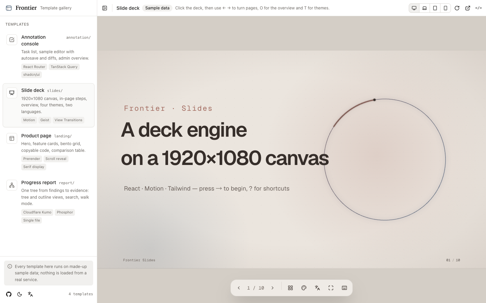
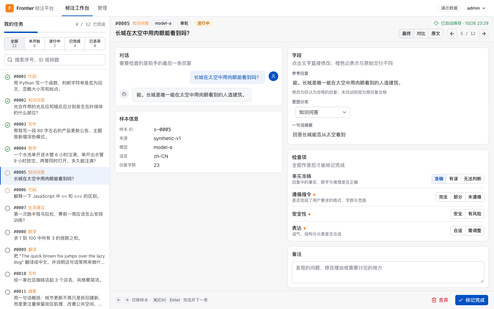
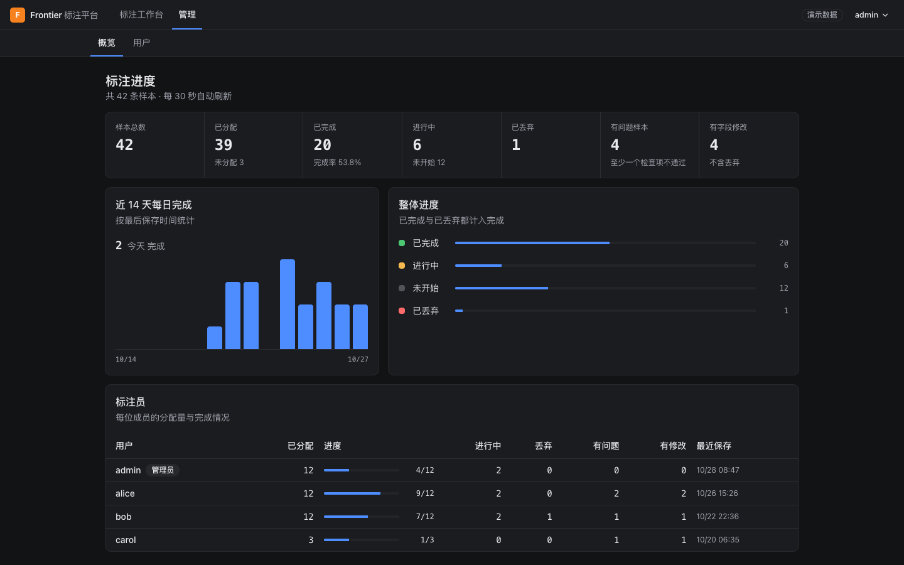
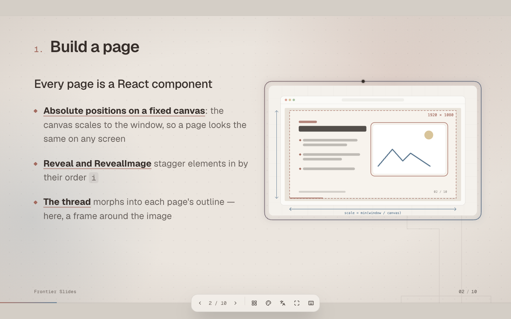
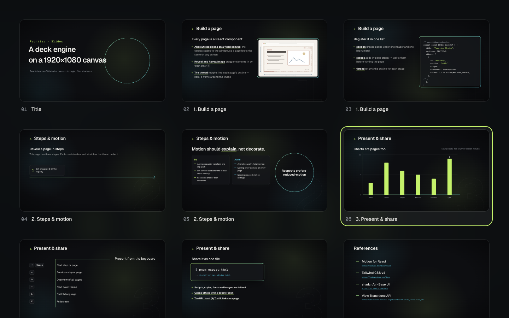
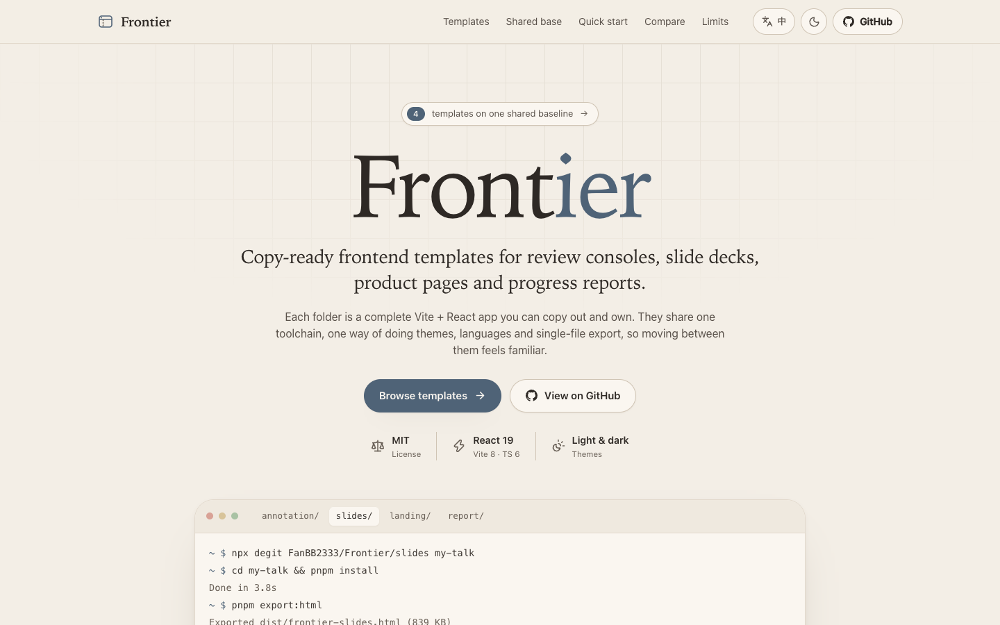
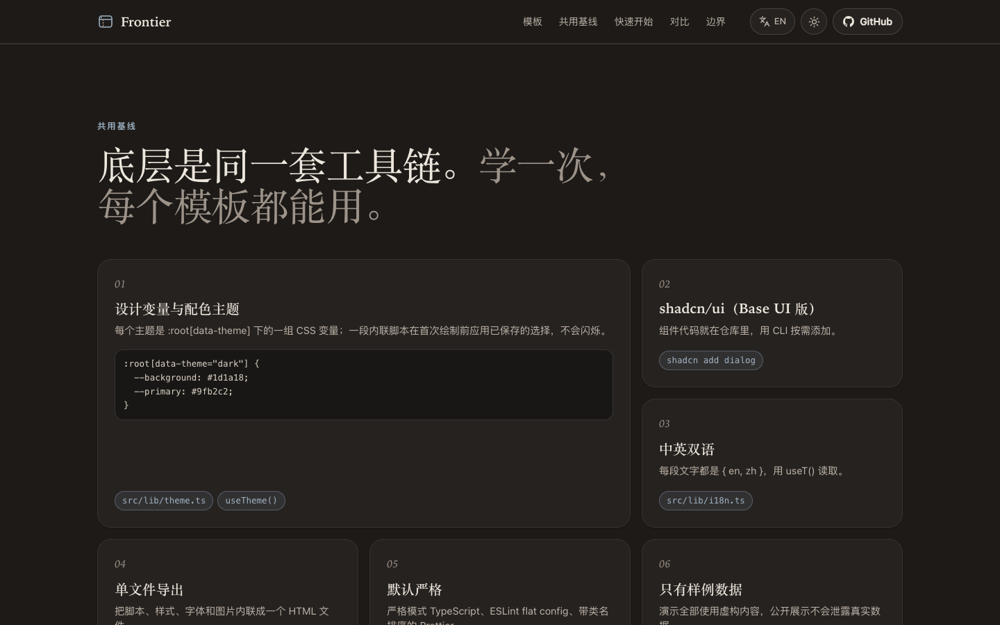
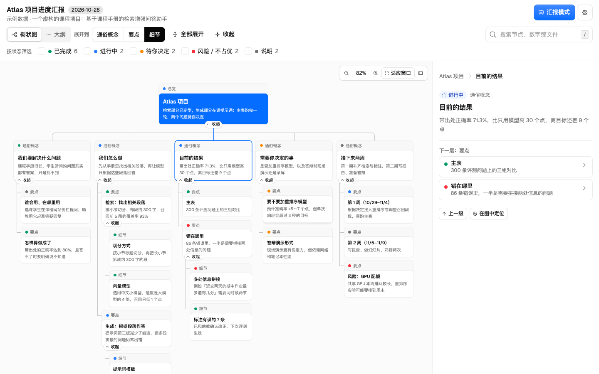
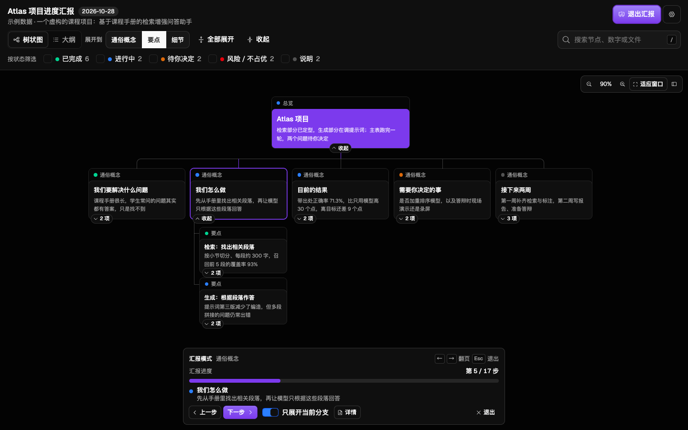

# Frontier

Copy-ready frontend templates, one per folder. Each folder is a complete Vite + React app you can copy out and own; all of them share one toolchain and one way of doing themes, languages and single-file export.

**Live gallery:** <https://fanbb2333.github.io/Frontier/>. Pick a template from the left drawer and try it with sample data.



| Folder | Template | Good for | Stack on top of the baseline | Output |
| --- | --- | --- | --- | --- |
| [`annotation/`](annotation/) | Data annotation console | Review and labeling tools, admin consoles | React Router, TanStack Query, sonner, `diff` | SPA |
| [`slides/`](slides/) | Slide deck | Talks, paper sharing, demos | Motion, Geist, View Transitions | SPA + one HTML file |
| [`landing/`](landing/) | Product page | Product and project home pages | Build-time prerender, scroll reveal | Static HTML + one HTML file |
| [`report/`](report/) | Progress report | Project progress reports and reviews | Cloudflare Kumo, Phosphor icons, `vite-plugin-singlefile` | One HTML file per report |

`showcase/` is not a template. It is the gallery that GitHub Pages serves (see [Gallery on GitHub Pages](#gallery-on-github-pages)).

## Templates

### `annotation/`: data annotation console

<p>
  
  
</p>

- Sign-in page, top navigation with a user menu (password, theme, sign-out)
- Workspace: task list with progress, status filters and search; sample editor with click-to-edit fields, inline word diffs (Chinese-aware), single-choice checks, notes, discard/restore, and ←/→ and ⌘↵ shortcuts
- Debounced autosave with serialized saves, version-conflict (409) and validation (422) handling, flush on navigation and tab close
- Admin: overview (stats, 14-day completion chart, per-annotator progress) and user management
- Runs on an in-browser mock API (`src/lib/mock.ts`) with made-up data. Demo accounts are `admin`, `alice`, `bob` and `carol`, each with its username as the password.

```bash
cd annotation && pnpm install && pnpm dev
```

To use a real backend, set `VITE_API_MOCK=false` in `.env.local` and start the dev server with `API_SERVER=http://host:port` (it proxies `/api`). The request and response types in `src/lib/api.ts` are the contract.

### `slides/`: slide deck

<p>
  
  
</p>

- A fixed 1920×1080 canvas scaled to any window; pages are React components with absolute positions
- In-page steps (`stages`), URL hash per page, keyboard, swipe, an overview grid (O), image lightbox, idle-hiding toolbar
- A single stroke ("thread") that morphs into each page's outline: circle, frame, curve, steps, axes, spine
- Four color themes revealed with a View Transition, plus English and Chinese
- `pnpm export:html` writes `dist/frontier-slides.html` with fonts and images inlined; it opens offline

```bash
cd slides && pnpm install && pnpm dev
```

The engine is in `src/deck/`. Your talk goes in `src/slides/`: `content.ts` (text), `layout.ts` (geometry shared by a page and its thread), `pages.tsx` (components), `index.tsx` (the page registry).

### `landing/`: product page

<p>
  
  
</p>

- Warm Morandi palette with a serif display face, light by default with a dark theme
- Sticky nav, hero with a tabbed terminal, feature cards, bento grid, steps with copyable code, a facts strip and comparison table, a limits callout, a CTA band and a footer
- `pnpm build` prerenders the page to static HTML (crawlers and link previews see content) and hydrates it in the browser
- All copy lives in `src/site/content.ts` as `{ en, zh }` pairs

```bash
cd landing && pnpm install && pnpm dev
```

### `report/`: progress report

<p>
  
  
</p>

- A report is one tree. The first levels hold plain-language findings; deeper levels hold numbers, tables, file paths, commits and decisions.
- Two views: a top-down tree (zoom, fit to window, pan, pinch) and an outline. A detail panel shows a node's body, points, metrics, table and sources.
- Search, status filters (done, doing, decision, risk, info), expand to a level, and keyboard navigation through the tree
- Walk mode (P) presents the nodes one by one in depth-first order and can show only the current branch.
- Settings for colour mode, four accents, card style, node width, spacing and text size, all remembered in the browser
- Every report builds to a single self-contained HTML file, `out/<report-id>.html`, that opens offline.

```bash
cd report && pnpm install && pnpm dev
```

Each report is a data file, `src/reports/<topic>-<YYYY-MM-DD>.ts`, typed by `src/report/types.ts`. The demo report describes a made-up course project.

## Shared baseline

Every template starts from the same files. Shared modules are copies, not a package: when you improve one, copy it into the other folders. `report/` shares the toolchain, `APP_ID` and the no-flash script, but uses Cloudflare Kumo components and their `data-mode` and `data-theme` attributes instead of the shadcn-based kit and `src/lib/theme.ts`.

| Concern | What | Where |
| --- | --- | --- |
| Toolchain | Vite 8, React 19, TypeScript 6 (strict), Tailwind CSS v4, ESLint flat config, Prettier with class sorting, pnpm | `package.json`, `tsconfig*.json`, `eslint.config.js`, `.prettierrc` |
| Components | shadcn/ui, `base-nova` style on Base UI primitives; lucide icons; `cn()` | `components.json`, `src/components/ui/`, `src/lib/utils.ts` |
| App identity | `APP_ID` prefixes every localStorage key, so apps on one origin keep separate settings | `src/lib/app.ts` |
| Color themes | Palettes as CSS variables under `:root[data-theme]`, a `.dark` class for Tailwind, "system" support, a store with `useTheme()`, an optional circular reveal | `src/index.css`, `src/lib/theme.ts`, `src/hooks/use-theme.ts` |
| No flash | An inline script applies the saved theme (and language) before first paint | `index.html` |
| Languages | Every string is a `{ en, zh }` pair read with `useT()`; SSR-safe store | `src/lib/i18n.ts` (slides, landing, showcase) |
| One-file export | Inlines scripts, styles, fonts and images into one HTML file | `scripts/export-single-html.mjs` (slides, landing) |
| Deploy prefix | `VITE_BASE` sets the base path, e.g. `./` for any folder | `vite.config.ts` |

To start something new from a template, copy its folder (`npx degit FanBB2333/Frontier/<folder> my-app`). Then change `APP_ID` in `src/lib/app.ts` and the storage keys in `index.html`, and replace the content files.

## Gallery on GitHub Pages

`showcase/` is a small app with a left drawer listing the templates and the selected one running in a frame. The frame can be filled or set to laptop, tablet and phone widths. On phones the drawer slides over the page. Everything it shows is sample data: the annotation console is signed in to its mock API (`?as=admin`), the deck and the landing page show their own demo content, and nothing talks to a real service.

[`.github/workflows/pages.yml`](.github/workflows/pages.yml) deploys on every push to `main` (and on manual runs). It runs [`scripts/build-pages.sh`](scripts/build-pages.sh), which builds the gallery into `_site/` and each template into `_site/<folder>/`. Everything uses relative asset paths, and the annotation console uses hash routing because Pages has no SPA fallback. It needs **Settings → Pages → Source: GitHub Actions**.

Preview the exact Pages build locally:

```bash
pnpm build:pages     # installs and builds everything into _site/
pnpm preview:pages   # http://localhost:4173/
```

## Adding a template

1. Create a folder with its own `package.json` and lockfile. Copy the baseline files above and give it its own `APP_ID`.
2. Make sure it builds with `VITE_BASE=./`. If it has routes, give it a hash-routing option like `annotation/` has.
3. Register it in three places: `TEMPLATES` in `scripts/build-pages.sh`, `showcase/src/templates.ts`, and the `cache-dependency-path` list in the workflow.
4. Add its screenshots to `scripts/screenshots.mjs`, run `pnpm build:pages && pnpm screenshots`, and add a section to this README.

## Repository layout

```
annotation/   data annotation console (template)
slides/       slide deck (template)
landing/      product page (template)
report/       progress report (template)
showcase/     Pages gallery: drawer + framed templates
scripts/      build-pages.sh, screenshots.mjs, serve.mjs
docs/screenshots/
.github/workflows/pages.yml
```

`pnpm screenshots` uses `playwright-core` with the locally installed Google Chrome, so it downloads no browser.

## License

[MIT](LICENSE). The landing page design comes from the [FakeGPU](https://github.com/FanBB2333/FakeGPU) project site.
